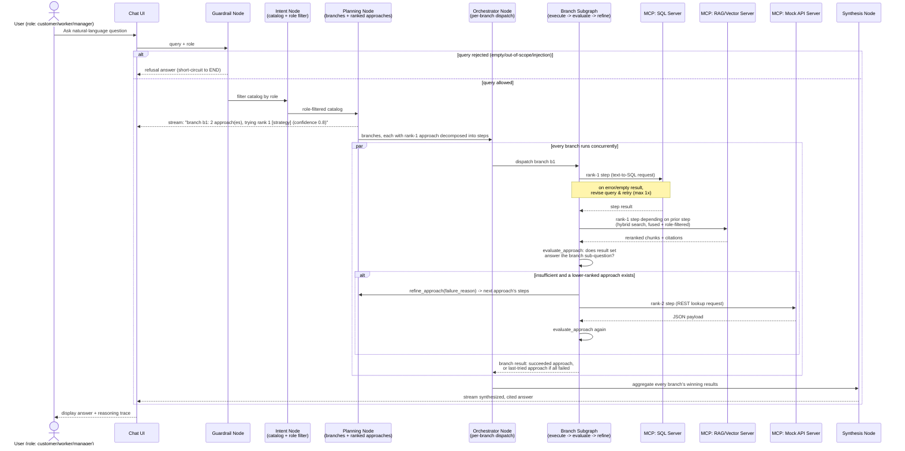
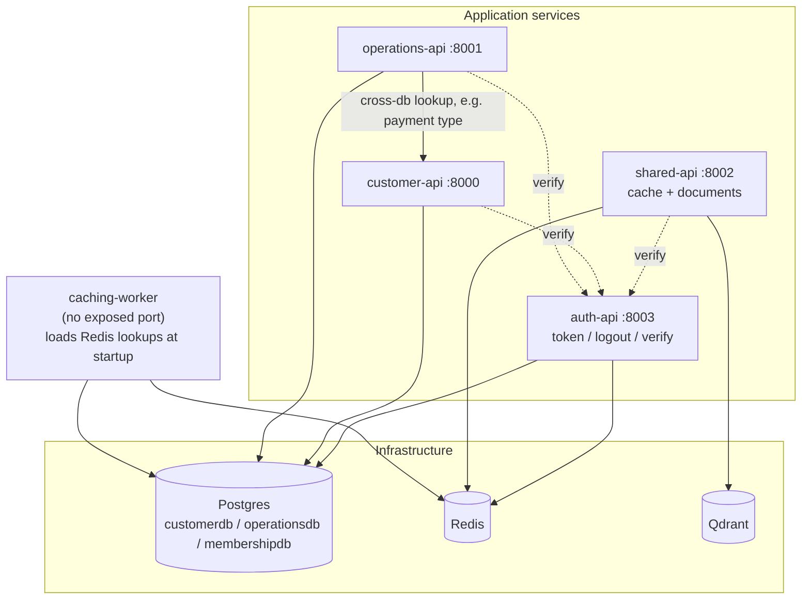
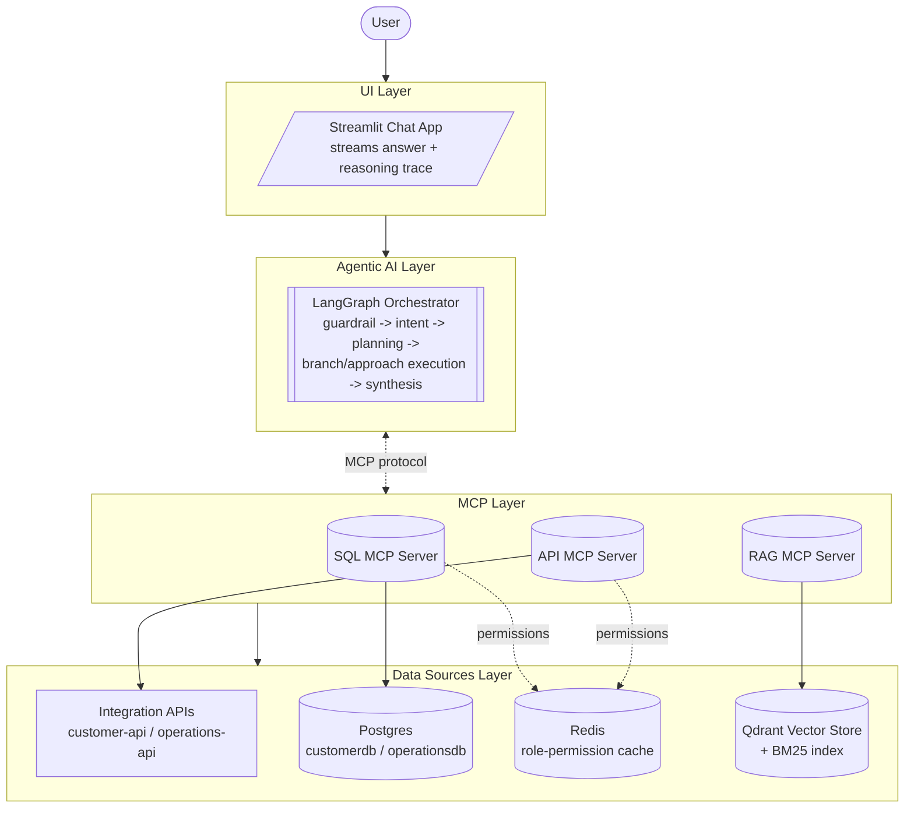
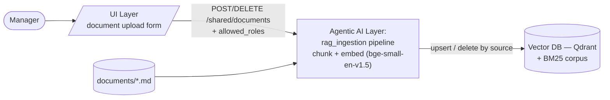
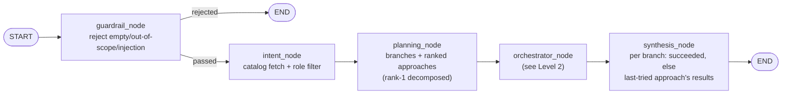
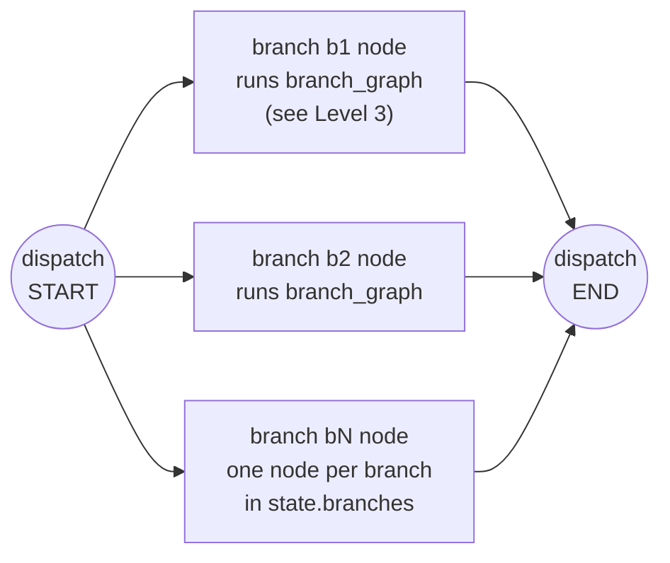
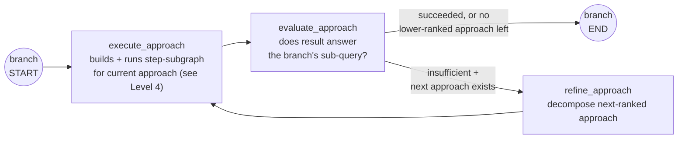
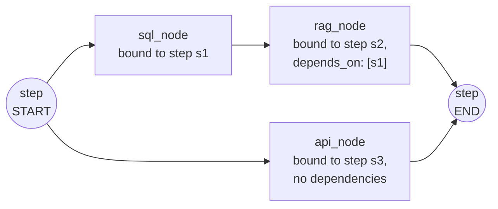

# Enterprise Federated Smart Search Engine — Version 1

> This document redefines [Concept.md](Concept.md) into a scoped, buildable v1. The original concept remains the long-term north star; this is the production-shaped first version that demonstrates **MCP**, **RAG**, and **smart/federated search** end-to-end.

## 1. Concept
A **federated smart search engine** that takes one natural-language query, routes it to the right data source(s) via MCP servers, retrieves in parallel, and returns a single synthesized, cited answer. It demonstrates agentic orchestration (LangGraph), the Model Context Protocol (multiple real MCP servers), and Retrieval-Augmented Generation — without the enterprise infrastructure (multi-database sprawl, full RBAC, multimodal pipelines) that a larger-scale system would eventually need.

## 2. Executive Summary
EFSSE v1 is a complete, production-shaped slice of the full vision: a LangGraph orchestrator guards the incoming query, splits it into independent **branches** (sub-intents), and for each branch tries a ranked **approach** — a dependency-ordered plan of steps mapped to one of **three MCP servers** (SQL database, RAG vector store, mock REST API). Each approach is self-evaluated against its branch's sub-question; a failed approach is refined into the next-ranked alternative and retried before the branch gives up. A synthesis node then merges every branch's best (or partial) results into one cited answer. Everything not required to prove these skills (MCP, RAG, smart federated search, self-correction) is explicitly deferred to a later version (see §10).

## 3. System Architecture & High-Level Workflow
* **Request Inception:** User submits a natural-language query; the caller's role (`customer`/`worker`/`manager`) comes from their JWT — see §8.
* **Guardrail:** A gate node rejects empty/gibberish input, out-of-scope requests, questions unanswerable in principle, and prompt-injection/instruction-override attempts before any planning happens — a rejected query short-circuits straight to a refusal answer.
* **Intent & Planning:** A node filters the source catalog (APIs / DB views / RAG doc headings) to what the caller's role can access. Planning then runs in two stages: it splits the query into independent branches (sub-intents), and for each branch proposes up to three ranked approaches (a strategy + confidence score each), fully decomposing only the top-ranked approach into typed, dependency-linked steps up front. Steps referencing a resource outside the role-filtered catalog are dropped (cascading to their dependents).
* **Branch-Parallel, Approach-Sequential Execution:** The orchestrator runs every branch concurrently. Within a branch, the current approach's steps execute in dependency order via MCP (steps with no unmet dependencies run concurrently, and a step's output threads into any step depending on it).
* **Self-Evaluation & Refine-Retry:** After an approach's steps finish, an evaluator judges whether the collected results actually answer the branch's sub-question (any step producing only errors/empty output fails immediately without an LLM call). If insufficient and a lower-ranked approach exists, the failure reason is fed back to the planner, which decomposes that next approach's steps, and the branch retries — up to as many ranked approaches as planning proposed (max 3).
* **Self-Correcting Text-to-SQL:** Independently of branch-level retry, the SQL Agent revises and retries its own query once on execution error or an empty result set.
* **Hybrid Retrieval:** The RAG Agent runs keyword (BM25) and vector search in parallel, fuses candidates by Reciprocal Rank Fusion, and filters by the caller's role before reranking.
* **Synthesis Node:** For each branch, takes the succeeded approach's results (or the last-tried approach's partial results if every approach failed), merges them across branches, attributes each fact to its source, and produces one cited natural-language answer.
* **Response:** The answer streams back alongside a live "reasoning trace" (guardrail verdict, branches/approaches tried, retries, and why).

### Workflow Diagram

### Architecture Overview

#### Microservices
The `integration/` layer (customer/operations microservices + their shared infra) that the SQL MCP server queries against. Auth is fully externalized to its own `auth-api` service — every other API calls it over HTTP (`POST /auth/verify`) instead of decoding JWTs or touching membershipdb itself. Dashed arrows are that auth check; solid arrows are direct DB/cache/HTTP calls.

#### Gen AI - Architecture
High-level layering — each box is a layer, not an implementation detail; internals (guardrail/intent/planning/branch/synthesis nodes) are covered separately in the "Gen AI - Node Graph" section below.

#### Document Upload (RAG Ingestion)
A manager-only path, separate from the query-time graph above, that adds/replaces/removes a RAG source document at runtime.

#### Gen AI - Node Graph (`agentic_core/graph.py`)
The graph nests three levels of dynamically-built subgraph inside one static top-level graph. Rather than one crowded diagram, each level is shown separately below, in the order execution reaches them — treat `orchestrator_node`, `branch_graph`, and the step-subgraph as call-outs of the box they replace in the diagram above them.

**Level 1 — top-level graph.** Flat and statically wired: `guardrail_node → intent_node → planning_node → orchestrator_node → synthesis_node`, with one conditional edge after `guardrail_node` that short-circuits a rejected query straight to `END`.

**Level 2 — `orchestrator_node`'s dispatch graph.** Built fresh per query: one node per `branch_id` in `state.branches`, all wired from `START` so every branch runs concurrently. Each branch node invokes the compiled `branch_graph` (Level 3) on a state copy scoped to that branch, and returns only that branch's own `step_results`/`trace` so concurrent branches never clobber each other.

**Level 3 — `branch_graph`** (`agentic_core/nodes/branch_node.py`), one instance per branch. A fixed 3-node retry loop: try the current approach, evaluate it, and either stop or refine the next-ranked approach and try again — up to 3 ranked approaches per branch.

**Level 4 — step-subgraph for one approach**, built fresh by `execute_approach` via `build_step_graph` (`agentic_core/nodes/step_graph.py`): one node per step (`sql_node`/`rag_node`/`api_node`, each bound to its specific `PlanStep` via `functools.partial`), with edges taken from each step's `depends_on`. LangGraph's normal fan-in semantics (a node runs once all its incoming edges have fired) give dependency-ordered, concurrent-where-possible execution for free. The shape below is one *example* (2 independent steps, one feeding a third) — actual step count and edges vary per plan, and a refined approach gets its own step-subgraph built the same way.

## 4. Tech Stack
| Component | Technology | Why this, for v1 |
| :--- | :--- | :--- |
| **Orchestration & State Machine** | LangGraph (Python) | Core skill to demonstrate; unchanged from full concept |
| **Planning LLM** | Gemini (`gemini-2.5-flash`) via `langchain-google-genai` | Structured-output query decomposition in `planning_node`; fast/cheap model is enough for a bounded, single-shot planning call |
| **Protocol Standard** | Python MCP SDK | 3 lightweight MCP servers instead of 5+ |
| **Structured Data** | Postgres (single instance, 3 databases) | Already the `integration/` layer's data store (customerdb/operationsdb/membershipdb via `docker-compose.yaml`); zero/low ops overhead vs. a full Postgres cluster |
| **Vector Store** | Qdrant (docker-compose service) | Real server-mode vector DB (vs. an embedded store) to demonstrate a production-shaped RAG setup; consistent with the rest of the project already running its infra via compose |
| **Embeddings** | `bge-small-en-v1.5` via `fastembed` | Small, CPU-friendly ONNX embedding model with no torch dependency |
| **Keyword Search / Rerank** | `rank_bm25` (+ RRF score fusion) | Cheap way to add hybrid retrieval, no extra infra |
| **API Source** | One mock/local FastAPI endpoint | Proves API-fan-out pattern without needing a real enterprise API |
| **UI Interface** | Streamlit multipage app (`frontend/`) | Fast to stand up; `Smart_Search.py` is the chat entrypoint, `pages/1_Upload_Documents.py` the manager-only document upload page, `components/stepper.py` renders the live reasoning trace scoped by `view_mode` |

**Deliberately dropped for v1:** MongoDB/NoSQL, MinIO/S3 blob storage, SQL OLAP warehouse, full dynamic RBAC engine (query rewriting/metadata-filter injection), multimodal/vision pipeline. See §10. (Document-level RBAC for RAG — see §8 — is a lighter, static version of this that *is* in scope.)

## 5. AI & DS Areas
* **Input Guardrailing:** An LLM gate that rejects empty/gibberish input, out-of-scope questions, questions unanswerable in principle, and prompt-injection/instruction-override attempts before any planning or retrieval happens.
* **Federated Agentic Search & Routing:** Query decomposition into independent branches (sub-intents) → parallel MCP tool invocation across sources (the headline skill).
* **Multi-Approach Planning with Self-Evaluation & Refine-Retry:** Each branch gets up to 3 ranked candidate approaches (strategy + confidence); an evaluator judges whether a completed approach's results actually answer the sub-question, and an insufficient approach triggers refinement of the next-ranked alternative before falling back to a partial answer.
* **Hybrid RAG Retrieval:** Chunking + embedding, combined BM25 keyword + vector search fused by Reciprocal Rank Fusion, and role-based filtering before citation.
* **Self-Correcting Text-to-SQL:** Natural-language → SQL translation and execution, with a bounded retry loop that revises the query on error or empty result.
* **Result Synthesis with Streaming Delivery:** Merging multi-branch, multi-source payloads into one coherent, attributed answer, streamed to the UI alongside a live reasoning trace.

## 6. Related Technologies/Libraries
* `langgraph`, `langchain-core`, `langchain-google-genai` (planning-node LLM calls)
* `mcp` (Model Context Protocol Python SDK)
* `pydantic` (state schema/validation)
* `qdrant-client`, `fastembed` (vector store + embeddings)
* `rank-bm25` (keyword search side of hybrid retrieval)
* `langchain-text-splitters` (markdown-header-aware + recursive chunking)
* `asyncpg` (Postgres driver, already used throughout `integration/`)
* `fastapi` (mock API + optional MCP transport)
* `asyncio` (parallel fan-out)

## 7. Data Sources Description
* **SQL Database:** The already-built `integration/` schemas (customerdb, operationsdb — synthetic data) to prove text-to-SQL + structured retrieval; the SQL MCP server queries against these via a role-scoped Postgres connection, not a separate demo database.
* **RAG Docs:** Five eKart policy/SOP markdown documents (`documents/`) chunked and embedded into Qdrant via the `rag_ingestion` pipeline. Each document (and therefore each of its chunks) carries an `allowed_roles` tag — see §8 — so retrieval can eventually be scoped to the caller's role. A manager can add, replace, or remove a document at runtime through `POST`/`DELETE /shared/documents` (shared-api) instead of only via the offline ingestion script.
* **Mock API:** One FastAPI endpoint simulating a live internal service (e.g., "order status" or "inventory lookup") to prove the API-fan-out pattern.

*(NoSQL, blob/image storage, and OLAP data are conceptually described in the full [Concept.md](Concept.md) but not implemented in v1.)*

## 8. Intent Layer
* **Role Tagging (scoped):** Query-time role comes from the real JWT roles already used across `integration/` — `customer`/`worker`/`manager` — rather than a separate demo-only role pair.
* **Guardrail (`guardrail_node` → `guardrail_service.check_query`):** Runs before the catalog is even fetched. An empty/whitespace query is rejected without an LLM call; otherwise one LLM call (Gemini, structured to a `GuardrailVerdict(allowed, reason)`) rejects out-of-scope questions, questions unanswerable in principle, and prompt-injection/instruction-override attempts. A rejection sets `guardrail_passed=False` and `answer=verdict.reason`, and `route_after_guardrail` routes straight to `END` — intent, planning, and execution never run for a rejected query.
* **Source Catalog Retrieval & Role Filtering (`intent_node` → `planning_service.build_catalog`):** The node assembles a catalog of everything queryable by calling each source's own `list_permissions()` — `sql_service` (manager-only, hardcoded), `rag_service` (per-document `allowed_roles` from `rag_ingestion/data/manifest.json`, itself derived from `ROLE_PERMISSIONS_DELTA` via `rag_ingestion/permissions.py` at ingestion time), and `api_service` (reads the `api-permissions:*` Redis keys that `caching-worker` populates from customer-api's/operations-api's actual route decorators, via `integration/shared/permissions.py`) — then keeps only the entries the caller's role is listed against. `ROLE_PERMISSIONS_DELTA` (`agentic_core/models/constants.py`) is therefore the ultimate source of truth for RAG/API permissions, but the catalog is filtered against each source's own live-materialized view of it, not the static dict directly. Only the filtered catalog is ever shown downstream, so planning can't surface a resource the caller isn't permitted to use.
* **Branch Decomposition & Ranked Approaches (`planning_node` → `planning_service.decompose_query`):** One LLM call (Gemini, via `langchain-google-genai`) takes the user query plus the filtered catalog and splits it into independent **branches** — one per sub-intent of the query. For each branch, the same call proposes up to 3 ranked candidate **approaches** (a `strategy` description + `confidence` score), but only the top-ranked (rank 1) approach is fully decomposed into typed steps up front — each step has a natural-language description, literal inputs (`input_params`) and/or references to another step's output (`input_refs`), and a mapping to one specific resource (one API endpoint / one SQL view-function / one RAG document) within one of the 3 sources. `depends_on` is derived programmatically from `input_refs` rather than asked of the LLM, so ordering can't drift from what a step actually consumes. `planning_node` drops any branch that ends up with zero approaches.
* **Plan Validation (`planning_service.validate_plan`):** Every step's mapped resource is checked against the role-filtered catalog; a step referencing a resource outside the caller's permitted set is dropped, cascading to any step that depended on it. Validation runs on a branch's rank-1 steps at planning time, and again on a refined approach's steps when `refine_approach` produces them (see §9's branch/approach retry loop).
* This is still a **scoped** design: a static catalog (no live schema introspection), bounded planning LLM calls (one decompose call, plus at most one refine call per failed approach, capped at 3 ranked approaches per branch — no unbounded re-planning), and no learned/adaptive planner.

## 9. Agents, MCP Servers, & Workflows
* **Worker Nodes:** One node per source — SQL Agent (`sql_node` → `sql_service`, with self-correct retry and list-input fan-out for array parameters), RAG Retriever (`rag_node` → `rag_service`, hybrid search + RRF fusion + role filter), API Handler (`api_node` → `api_service`) — each a thin wrapper calling its MCP server. Each is invoked **once per plan step mapped to it, per approach attempt** — a retried approach re-runs its own steps under a fresh composite key (`branch_id.approach_rank.step_id`, from `execution_service.step_result_key`), so results from a failed approach never collide with or leak into the retry.
* **Input Resolution (`agentic_core/services/execution_service.py`):** Shared by all three worker nodes — `resolve_step_inputs` merges a step's literal `input_params` with values pulled from upstream `StepResult`s via `input_refs` (dict field extraction, per-row extraction from a list of dicts, or scalar-unwrap of a single-row list); `missing_refs`/`missing_refs_error` short-circuit a step whose required upstream data is missing or errored, without calling its MCP server.
* **MCP Servers:** Three standalone MCP servers (SQL, RAG, Mock API), each exposing one clear tool via the MCP SDK.
* **RAG Ingestion:** A separate, non-graph pipeline (`rag_ingestion/`) chunks, embeds, and upserts `documents/*.md` into Qdrant. `scripts/ingest_documents.py` does this incrementally (skips files whose content hash is unchanged); `rag_ingestion/build_index.py` does a full from-scratch rebuild. The same single-file logic is reused by the manager document-upload endpoint (`POST`/`DELETE /shared/documents`), so an admin can add/replace/remove one RAG source document at runtime without re-running the whole pipeline (see the "Document Upload" diagram in §3).
* **Branch/Approach Retry Loop (`agentic_core/nodes/branch_node.py`, `agentic_core/routes/branch_retry_routing.py`):** The compiled `branch_graph` is a fixed 3-node cycle: `execute_approach` builds and runs a fresh per-approach step-subgraph (via `build_step_graph`), `evaluate_approach` calls `evaluation_service.evaluate_approach` to judge whether the collected results answer the branch's sub-query (an approach whose every step errored or returned nothing fails immediately with no LLM call; otherwise one structured LLM call judges sufficiency), and `route_after_evaluate` sends a succeeded (or exhausted) approach to `END`, or an insufficient one with a lower-ranked alternative still available to `refine_approach`. `refine_approach` calls `planning_service.refine_approach` (one LLM call, using the failure reason as feedback) to decompose the next-ranked approach's steps, validates them against the catalog, and loops back into `execute_approach`.
* **LangGraph Workflow:** `guardrail (reject bad input) → intent (catalog fetch + role filter) → plan (branch decomposition + ranked approaches) → orchestrate (per-branch dispatch of the branch/approach retry loop) → synthesis → stream respond` — a flat, statically-wired top-level graph (`agentic_core/graph.py`) with one conditional edge after `guardrail_node`. All the dynamic scheduling lives inside `orchestrator_node`, which builds a **dispatch graph** with one node per branch (all running concurrently from `START`), each invoking the compiled `branch_graph` on a state copy scoped to that branch so sibling branches' `step_results`/`trace` never clobber each other. Inside a branch, `execute_approach` builds a **fresh `StateGraph`** from the current approach's steps, wiring one node per step (`sql_node`/`rag_node`/`api_node`, each bound to its specific step via `functools.partial`) with edges taken directly from each step's `depends_on`. LangGraph's normal edge semantics already provide the DAG scheduling this needs — a step with multiple incoming edges only runs once all of them have completed, and independent steps execute concurrently — so no custom dispatcher/scheduler loop is needed anywhere in this nesting. The live reasoning trace (guardrail verdict, branches and approaches tried, retries triggered, what each step returned) streams to the UI for transparency.

## 10. Deferred to Future Versions
To keep v1 focused, the following from the original concept are explicitly out of scope for now:
* NoSQL store, Blob/S3 storage, SQL OLAP warehouse
* Full dynamic RBAC (query rewriting, metadata-filter injection)
* Multimodal / vision-language image processing
* Cross-encoder re-ranking (BM25 + vector fusion via RRF is in scope and implemented; a learned cross-encoder reranker is not)
* Critic/validation node for cross-source discrepancy resolution (v1's synthesis node merges + cites per branch; it doesn't reconcile conflicting facts across branches)
* A dedicated per-row fan-out step type in the plan model. v1 handles the common case inside `api_node` only: when exactly one path parameter resolves to a list, the endpoint is called once per value (de-duplicated, capped at 25) and the rows are merged. Two list-valued path params, or more than 25 values, still fail the step.

These remain valid next-iteration additions once v1 proves the core MCP + RAG + smart-search pattern end-to-end.
