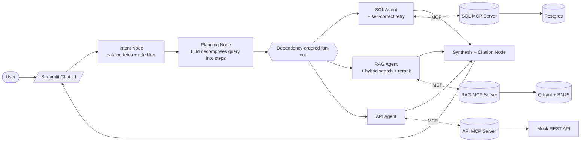
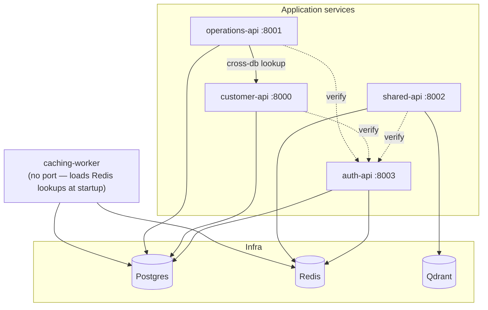

# EFSSE — Enterprise Federated Smart Search Engine

A portfolio project demonstrating **agentic orchestration (LangGraph)**, the **Model Context Protocol (MCP)**, and **hybrid Retrieval-Augmented Generation (RAG)** through a realistic federated search use case.

One natural-language question comes in; the system plans a set of sub-queries, fans them out — in dependency order and in parallel where possible — across three independent data sources (a SQL database, a RAG vector store, and a REST API), each behind its own MCP server, then merges the results into a single cited answer.

## Why this project exists

Most RAG demos hit one vector store. Most agent demos call one tool. EFSSE is built to show what it looks like when an LLM has to **decide which of several heterogeneous sources actually answer a question**, respect **per-role access control** while doing it, and **recover from its own mistakes** (a bad SQL query, a thin retrieval) instead of just failing.

## Skills demonstrated

| Area | What's shown |
| :--- | :--- |
| **Agentic orchestration** | A stateful LangGraph pipeline (`intent → plan → fan-out → synthesis`) where a node dynamically builds and compiles its own per-query subgraph to express step dependencies as graph edges. |
| **Model Context Protocol** | Three standalone MCP servers (SQL, RAG, API), each a thin, single-tool wrapper — business logic lives in `services/`, not in the protocol layer. |
| **Federated / smart search** | A single query is decomposed into typed sub-queries, each mapped to exactly one resource across three heterogeneous backends, executed concurrently where dependencies allow. |
| **Hybrid RAG retrieval** | BM25 keyword search + vector search run in parallel and are reranked before citation, instead of relying on embedding similarity alone. |
| **Self-correcting text-to-SQL** | The SQL agent validates its own output; on an error or empty result it feeds the failure back to the LLM for one revised attempt. |
| **Role-based access control end-to-end** | A real JWT auth service (`auth-api`) gates every downstream API; the same role model filters what the planner is even allowed to see, and RAG documents carry per-document `allowed_roles`. |
| **Microservice system design** | Four independently deployable FastAPI services + Postgres/Redis/Qdrant, wired through Docker Compose, with auth fully externalized rather than duplicated per service. |

## How a query flows



1. **Intent** — builds a catalog of every queryable resource (SQL views, RAG documents, API endpoints), filtered down to what the caller's role (`customer` / `worker` / `manager`) is allowed to see.
2. **Planning** — one LLM call (Gemini) decomposes the question into a plan of typed steps, each mapped to a single resource, with dependencies inferred from which steps consume another step's output. Steps that point outside the role-filtered catalog are rejected.
3. **Fan-out** — for each query, a *fresh* LangGraph subgraph is compiled from the plan's steps and dependency edges. Independent steps run concurrently; a dependent step only fires once its predecessors complete — LangGraph's native fan-in, no custom scheduler.
4. **Synthesis** — merges every step's result, attributes each fact to its source, and streams one cited answer back to the UI alongside a live reasoning trace.

See [Concept-V1.md](Concept-V1.md) for the full v1 spec (sequence diagram, node-graph diagram, deferred scope) and [Concept.md](Concept.md) for the long-term vision.

## Architecture

### Application layer (`agentic_core/`)

```
graph.py       LangGraph StateGraph wiring — no business logic
nodes/         intent, planning, fanout, sql, rag, api, guardrail, synthesis
services/      query building, retries, reranking — the actual business logic
mcp_servers/   3 standalone MCP servers (sql/rag/api) — validate, call service, return
state/         LangGraph state + pydantic models
models/        shared enums/constants, incl. the role→resource permission map
prompts/       prompt templates as plain functions/constants
```

`nodes → services → mcp_servers` is a one-way dependency: MCP servers stay thin, all logic (retries, reranking, SQL self-correction) lives in `services/`.

### Data & retrieval

- **`rag_ingestion/`** — standalone pipeline: chunk `documents/*.md` (markdown-header + recursive splitting) → embed with `bge-small-en-v1.5` (fastembed, CPU-only) → upsert into Qdrant. Tracks a manifest so re-ingestion skips unchanged files and preserves granted roles. Reused at query time by `rag_service` and by the manager document-upload API.
- **Postgres** — one instance, three databases (`customerdb`, `operationsdb`, `membershipdb`), each with least-privilege `customer`/`worker`/`manager` login roles scoped to a view/function schema — no direct table access.
- **Qdrant** — vector store for the RAG corpus (384-dim embeddings).
- **Redis** — auth-token cache and shared API-permission cache.

### Microservices (`integration/`)

A separate, already-built enterprise-data layer that the SQL MCP server queries against — not part of the LangGraph app itself.



- **auth-api** — the *only* service holding the JWT secret or a membershipdb connection. Issues tokens on login, caches identity in Redis (`auth:{jti}`), and every other service calls `POST /auth/verify` over HTTP instead of decoding JWTs itself — so revocation is just "is the cache entry still there."
- **shared-api** — generic Redis cache endpoints + manager-only document management (`POST`/`DELETE /shared/documents`), which drives RAG ingestion for runtime document upload/removal.
- **customer-api** / **operations-api** — domain CRUD services (profile/addresses/payments; products/orders/invoices/deliveries), each with its own thin `auth_client.py` calling auth-api rather than importing a shared auth module — keeps every service independently deployable.
- **caching-worker** — loads lookup data (locations, product categories, statuses) into Redis once at startup, and publishes each API's role-permission map (via route reflection) for the Intent node to read.

### Role-based access control

`ROLE_PERMISSIONS_DELTA` (`agentic_core/models/constants.py`) is the single source of truth for which role can reach which resource. It's projected out to each source at its own layer: SQL access is manager-only by design, API permissions are derived from live route decorators and cached in Redis, and RAG documents carry a per-document `allowed_roles` list (stored in the Qdrant payload and the ingestion manifest) that a manager can override on upload.

## 🧰 Tech stack

**🤖 Agentic AI & LLMs**  
    

**🔎 Retrieval (RAG)**  
    

**🗄️ Data & Cache**  
  

**⚙️ Services & Auth**  
   

**🖥️ UI & Testing**  
  

## Repository layout

```
agentic_core/       LangGraph app: graph, nodes, services, mcp_servers, state, models, prompts
rag_ingestion/       Offline/on-demand RAG ingestion pipeline (chunk, embed, upsert, manifest)
integration/         Independent microservice layer: auth-api, shared-api, customer-api,
                     operations-api, caching-worker + their Postgres schemas
frontend/            Streamlit chat UI (app.py, components, pages, session/graph runner)
documents/           Source markdown policy/SOP documents ingested into RAG
scripts/             Incremental ingestion CLI, DB setup scripts
tests/               pytest suite
docker-compose.yaml  Full stack: postgres, redis, qdrant, auth-api, shared-api,
                     customer-api, operations-api, caching-worker
main.py              CLI runner for the graph (no UI)
app.py               Streamlit entrypoint
```

## Running it

> Startup order matters — Compose does not create or seed the databases.

```bash
docker compose up -d postgres redis
```

Run the database setup script once Postgres is healthy (`scripts/recreate-databases.ps1`, or see [project-notes/DbSetup.md](project-notes/DbSetup.md)), then:

```bash
docker compose up -d
```

Ingest the RAG corpus:

```bash
python scripts/ingest_documents.py
```

Launch the chat UI:

```bash
streamlit run app.py
```

Or drive the graph directly without the UI:

```bash
python main.py
```

Copy `.env.example` to `.env` and fill in your Gemini API key and any local overrides before running.

## Automated executions

PowerShell helper scripts under `scripts/` for local dev — each reads config from `.env` at the repo root.

**`app-start.ps1`** — brings up Postgres/Redis, optionally (re)seeds the databases, brings up the rest of the stack, installs Python deps, optionally ingests the RAG corpus, and launches the Streamlit UI.

```bash
.\scripts\app-start.ps1                    # start stack (no DB reset/rebuild) + launch UI
.\scripts\app-start.ps1 -SeedDb             # also recreate/seed databases first
.\scripts\app-start.ps1 -Build              # rebuild docker images before starting
.\scripts\app-start.ps1 -SkipIngest         # skip RAG document ingestion
.\scripts\app-start.ps1 -Port 8600          # run Streamlit on a different port
```

**`recreate-databases.ps1`** — drops and recreates `customerdb`, `operationsdb`, and `membershipdb` on the Postgres container, then reapplies their schema and seed scripts.

```bash
.\scripts\recreate-databases.ps1
```

**`ingest-documents-vdb.ps1`** — brings up Qdrant and (re)ingests `documents/*.md` into it for RAG.

```bash
.\scripts\ingest-documents-vdb.ps1
```

**`test-execution.ps1`** — runs everything `tests/test_execution.md` describes by hand: brings up the stack, (re)seeds the databases, ingests the RAG docs, and runs the integration tests.

```bash
.\scripts\test-execution.ps1                           # full reset + run
.\scripts\test-execution.ps1 -SkipDbReset               # keep existing DB data
.\scripts\test-execution.ps1 -SkipIngest                # skip RAG (re)ingestion
.\scripts\test-execution.ps1 -SkipBuild                 # don't rebuild images first
.\scripts\test-execution.ps1 -TestArgs "-k customer"     # extra pytest args
```

## Results

Measured on a live stack with Gemini 2.5 Flash-Lite (set via `PLANNING_MODEL`): 16 of 16 integration tests pass; across a 10-case x 3-run eval, source routing and document citation were 100% correct with 0 RBAC leaks, and fact match was 80%. Median latency 7.3s (p95 27.4s), median 7,869 tokens per query, about $0.001 per query (LangSmith estimate). Known gaps: the order-1 payment method lookup and the manager revenue query are unreliable. Reproduction steps: [tests/eval/README.md](tests/eval/README.md).
